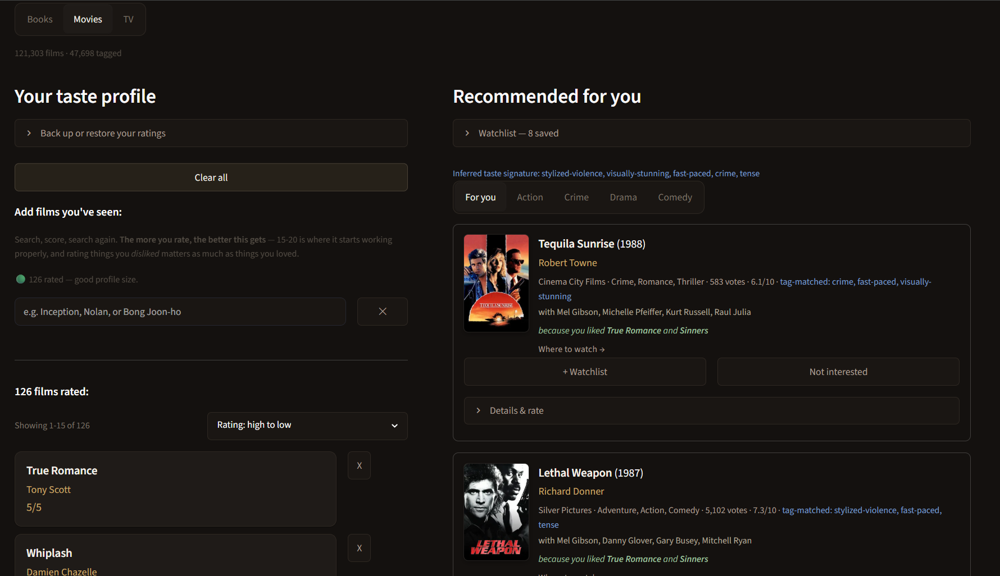

# Multi-Modal Recommendation Engine

A content-based recommender for books, films, and TV that runs off a single taste profile. You rate a few things in any medium, and it gives you back a ranked list with a short reason attached to each pick. I built it as a portfolio project and as something I actually use.

**Live demo:** [huggingface.co/spaces/Arya2305/recommendation-engine](https://huggingface.co/spaces/Arya2305/recommendation-engine)



---

## What is in it

Three corpora, one embedding space, one ranking engine.

| Corpus | Titles | Tagged | Source |
|--------|-------:|-------:|--------|
| Books  |  74,074 | 63,933 | Hardcover GraphQL API, plus the 2017 UCSD Goodreads dump |
| Films  | 121,303 | 47,698 | TMDB (Kaggle dump) and IMDb non-commercial credits |
| TV     |  30,235 | 15,183 | TMDB TV dump (Kaggle) |

The system is content-based. It recommends things because they look like what you already rated, not because other people who liked X also liked Y. That was a deliberate choice for v1, and the evaluation section puts a number on what it costs.

## How it works

```
rated items -> BGE-M3 embeddings -> FAISS neighbour search -> whole-profile ranker -> explained recommendations
```

**Embeddings.** Every title gets encoded with [BAAI/bge-m3](https://huggingface.co/BAAI/bge-m3), a 568M parameter multilingual model that outputs 1024 numbers per item. Two items with similar numbers are similar in meaning. Multilingual matters because a lot of the film and book metadata is not in English. I compute all the vectors offline on my GPU, so no model runs when someone opens the app.

One thing I learned the hard way: the title is not part of the text I embed. When it was, items matched each other on shared words in their names instead of on what they were actually about. That was behind a lot of the early bad recommendations.

**Search.** A FAISS `IndexFlatIP` index per corpus, which is cosine similarity over normalised vectors. At serving time I rebuild vectors from the index instead of loading a second copy, which saves about 2.3 GB of RAM on the free CPU Space.

**Ranking.** This is where most of the work is. See the next section.

**Serving.** Streamlit on Hugging Face Spaces, in Docker, pulling the precomputed files from a companion Datasets repo at startup. There are tabs per medium, genre sub-tabs, watchlists, star ratings, and localStorage so your profile survives a refresh.

There is also an experimental chat interface (Claude Haiku over the same corpora) with simpler scoring. It is a natural-language way in, not a replacement for the ranker.

## The ranking engine

The ranker takes your whole profile and returns one ordered list. Here is each piece and what it is for.

**Every rating counts, including bad ones.** Each rated item pulls or pushes candidates with a weight of `rating - 3`. A 5 pulls hard, a 1 pushes hard, a 3 does nothing. So it is not "more like your favourite film", it is scored against everything you have rated at once.

**Tags, centred on the candidate pool.** The score is `embedding score + w * (tag similarity - pool mean)`. The earlier version blended raw tag similarity in, which turned out to be a pure penalty: every tagged candidate scored worse than an untagged one, all 127 of them. Subtracting the pool mean fixed it.

**It tells you why.** A candidate can be found by more than one thing you rated, and the ranker keeps track, so a pick can come back as "because you liked Collateral and Fargo".

**Dislikes suppress neighbours.** Anything sitting close to something you rated 1 or 2 gets pushed down across the whole list.

**A quality floor.** A vote-average floor plus shrinkage toward the corpus average, so a title with three 5-star votes does not outrank something a lot of people liked. The thresholds are set per corpus. TV's vote ceiling is 2,000 against 8,000 for films, because TV has its own vote distribution and borrowing the film numbers gave nonsense.

**Diversity.** Anchors are picked greedily by pushing them as far apart as possible, so the list is not ten neighbours of one film.

**Sequel suppression.** A penalty on candidates that share title words with something you rated. The point of the app is to surface things you would not have found yourself, and you do not need an app to tell you about the sequel.

**Age and content filters.** Films use a certification tier with 92.9% coverage. TV uses a 0 to 5 maturity scale built from content ratings with 99.3% coverage, and drops shows sitting three or more levels below your profile median.

There is also a `flat_ranking` mode on all three corpora that turns the diversity machinery off, so offline evaluation measures the scoring rather than the shuffling.

## Cross-modal: "From your films"

All three corpora use the same model at the same size, so a film vector can search the book index directly. That is the whole trick.

Retrieval happens per film, but scoring is done against your whole profile. I tried averaging all the films into one vector first, and a profile of 53 films returned James Patterson and a Warcraft tie-in novel. The average of everything is close to everything and specific to nothing. Scoring each retrieved book against the full profile fixed it, and it means a book can arrive with two reasons attached, and books that sit near a film you rated 1 get pushed down.

What I measured: retrieval. Given 10 films with known source novels, 8 return the novel in the top 10 and 5 return it at rank 1. *The Shining* scores 0.891, *Dune* 0.809, and *Blade Runner* finds *Do Androids Dream of Electric Sheep?* at 0.761.

What I did not measure: whether the recommendations are any good. No public dataset connects one person's films to their books, so my offline harness cannot see this tab at all. I shipped it on judgement. The failure I know about is tone. Collateral plus Fargo returns a cozy coffeehouse mystery, which matches the plot words and misses the mood completely. Plot summaries carry subject matter, not register.

## Evaluation

Two offline harnesses, both leave-one-out. Both read their file paths from the app's own constants instead of hardcoding them, because an earlier version had been quietly evaluating an old copy of the corpus.

### Films, MovieLens ml-25m, 100 users

| | recall@20 |
|---|---:|
| popularity baseline | **0.080** |
| this engine | 0.043 |

The engine loses to just recommending popular films. Instead of tuning until that went away, I ran an ablation to find out where the recall was going. The deltas are paired per user, so `t = delta / paired standard error`, and I treat anything under `|t| = 2` as user-level noise rather than a real effect.

| Component removed | Change in recall@20 | t | Verdict |
|---|---:|---:|---|
| tag layer | -0.0132 (-31%) | -2.3 | real, worth keeping |
| vote average floor | -0.0127 (-30%) | -2.5 | real, worth keeping |
| sequel penalty | **+0.0120 (+28%)** | +2.1 | real, and spent on purpose |
| diversity round-robin | +0.0039 | 0.4 | **noise** |

Two things worth pulling out of that table.

The sequel penalty is the recall cost, and it is supposed to be. MovieLens rewards you for recommending *Toy Story 3* to someone who just rated *Toy Story 2*. I would rather lose that point.

The diversity round-robin costs nothing measurable. An earlier writeup of this project blamed it for a big share of the loss, and that was wrong. Unpaired, the numbers looked expensive. Once the comparison was paired per user, the effect disappeared into the noise. The correction only exists because I changed the statistics, not the code.

### Books, goodbooks-10k, 200 users

| Config | recall@20 |
|---|---:|
| popularity baseline | **0.056** |
| full engine | 0.016 |
| author cap = 1 | 0.008 |
| author cap = 2 (shipped) | 0.010 |
| author cap = 3 | 0.012 |
| tag layer removed | 0.014 (inside noise) |
| author-adjacency penalty on | 0.016 (free) |

This is the first evaluation the books side has ever had. 87.9% of goodbooks titles match into my corpus on title and author.

The interesting row is the tag layer. On films it is a 31% effect. On books it is noise. Same code, different corpus, opposite answer, which is why I do not carry a result from one corpus over to another.

### The honest version

A content-only ranker does not beat a popularity baseline for mainstream raters, at any k, on either corpus. I had a note claiming a crossover at recall@50, and that crossover is against my own earlier version, not against popularity. Stated without naming the baseline it reads as a much better result than it is.

That gap is the argument for collaborative filtering in v3. The number to beat is 0.080.

## Things I measured and then did not build

Three features that were specified, measured, and dropped on the evidence. I am listing them because deciding not to ship is part of the work.

**Edition deduplication for books.** 392 redundant rows, 302 of them already caught by the existing duplicate check, 79 actually reaching users. That is 0.16% of the corpus, which does not justify touching the ranker. The same problem is worth fixing on the profile side though, where 40 volumes of one series become 40 anchors pointing at the same neighbourhood. That one is on the backlog.

**A young adult filter for books.** Hardcover's genre tags describe who reads a book, not who it was written for. *The Great Gatsby* is tagged Young Adult and *The Hobbit* is Middle Grade. The only threshold strict enough to catch the original complaint would have hidden 30.8% of the corpus.

**A popularity prior for films.** Every weight I tried came out as noise (best t = 1.2), and the paired standard error got *bigger* as the weight went up, which means it was helping some users and hurting others by about the same amount.

## The bug that kept coming back

Most of the expensive bugs in this project were the same bug wearing different clothes: a label that looks like it describes an audience actually describes something else.

**G in 1968** is not the G we have now, because PG-13 did not exist yet. *2001*, *North by Northwest*, and *Gone with the Wind* are all rated G. One 5-star rating of *2001* switched the kids filter off for a 122-film adult profile.

**Brazil's `L` and Spain's `TP`** mean "nothing objectionable in here", not "made for children". A telenovela ended up next to *Paw Patrol* at maturity 0.

**Canadian `C` means children. Mexican `C` means adult.** They were both keys in the same dict literal, so the second one silently overwrote the first, and Canadian kids' TV got relabelled as adult with no error anywhere.

**Comic collections** carry five different genre labels between them, so a cap on the first genre never actually bound to anything. 14 of the first 20 cross-modal results were superhero comics.

Every one of these turned up by printing example titles. None of them were visible in a distribution table. The coverage numbers looked fine in all four cases.

## Finding the missing book descriptions

*The Maltese Falcon* was missing from a 74,000 book corpus, and chasing that down turned into the most useful debugging of the project.

My first theory was edition selection. The API returns the most-read edition first, and if that edition has no description, the whole book gets dropped. I wrote a harvester to go looking at the other editions. It found that 19 of the 27 missing books had no description on any edition at all. Theory wrong.

So I tried four sources and got four different kinds of failure.

| Source | Result |
|---|---|
| Hardcover | 8 of 27 |
| Open Library (works, editions, first sentence) | 2 of 19 |
| Google Books | rate-limited without a key, never properly tested |
| Wikipedia | **19 of 19, and every single one was the author's page** |
| Goodreads 2017 academic dump (2.36M books) | **12 of 19**, author-verified, real summaries |

The Wikipedia row is the one to look at twice. A 100% hit rate that was actually three documents. Thirteen different books by one author all resolved to the same 500-character biography. If I had trusted the hit rate, those thirteen books would have collapsed into one vector and quietly ruined that whole neighbourhood.

Matching on title alone had the same problem at 2.36M rows. Searching for an S. Hussain Zaidi title returned David Baldacci's *Zero Day*. Checking the author too is not optional at that scale.

The descriptions were never missing. They were sitting behind an API that Goodreads shut down in 2020.

## Tech stack

Python 3.11, SentenceTransformers (BGE-M3), FAISS, Streamlit, the Anthropic SDK (Claude Haiku), Hugging Face Spaces and Datasets, Docker, pandas, numpy, pyarrow. Embeddings are computed on an RTX 4060 locally. Serving is CPU only.

## Limitations

**No collaborative filtering.** It cannot learn from other people's behaviour, and the cost of that is measured above.

**Tone is invisible to it.** Plot summaries describe what happens, not how it feels. Anthony Bourdain returns *The Flight Attendant*. Collateral returns a cozy mystery.

**Cross-modal quality is unmeasured.** I checked that retrieval works. Whether the recommendations are good is my opinion, not a number.

**Some thresholds are reasoned, not measured.** The TV maturity drop and the kids filter minimums came from reading example output, not from a sweep.

**Book coverage is uneven.** Indian regional non-fiction is thin in the live API, and the 2017 dump that fills the gap brings staleness back with it.

**Offline evaluation only.** Held-out ratings, no live A/B test.

**One profile at a time.** There is no multi-user backend yet.

## Roadmap

**v2.** Refresh the data layer first as one chunk: new TMDB pull, keyword tagging for films and TV, upgraded embeddings. Then rebuild the web app as separate shippable pieces: React, FastAPI, Postgres, and login. Data before app, so I am not redoing the data layer twice.

**v3.** Collaborative filtering (matrix factorisation, then Spark ALS) aimed at that 0.080 gap, plus a vector DB and a supervisor agent over the three corpora.

## Running it locally

The live demo is the easy way to try it. To run the app locally you need the precomputed embeddings and index from the companion Datasets repo, since they are too big for git. With those in place it is a normal Streamlit app:

```bash
python -m streamlit run app.py
```

## Reproducing the pipeline

The pipeline (corpus build, tagging, embedding, evaluation) is written up as `make` targets. The [Makefile](Makefile) has the stage graph and lists which raw files go where. There is a container for it:

```bash
docker build -t rec-engine-pipeline .
docker run -it --rm -v "$(pwd)":/work rec-engine-pipeline
make movies-corpus   # for example
```

The raw dumps are not in the repo. Embedding runs on the GPU on the host in practice, though the container will do it on CPU.

## Data and acknowledgements

Built on public datasets: the Hardcover API and the UCSD Goodreads dump for books, TMDB and IMDb non-commercial data for films, TMDB for TV, and MovieLens ml-25m plus goodbooks-10k for evaluation. Each keeps its own licence and terms. This is a non-commercial personal and portfolio project.

The Goodreads dump is academic use only: Mengting Wan and Julian McAuley, "Item Recommendation on Monotonic Behavior Chains", RecSys 2018. Rows that came from it are marked `source="hardcover+goodreads_dump_2017"` in the corpus.

Embedding model: BAAI/bge-m3.

## Licence

MIT. See [LICENSE](LICENSE).
